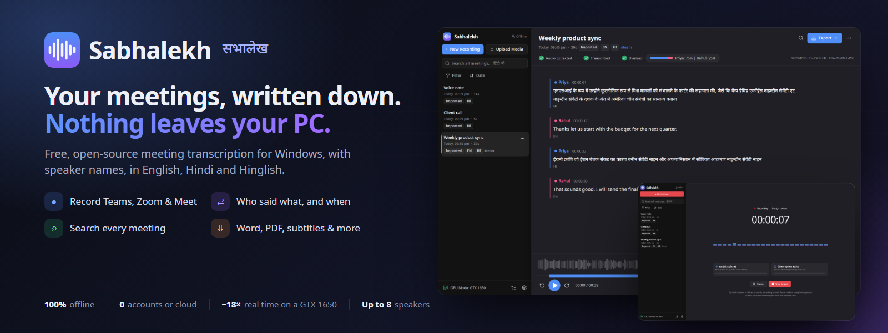
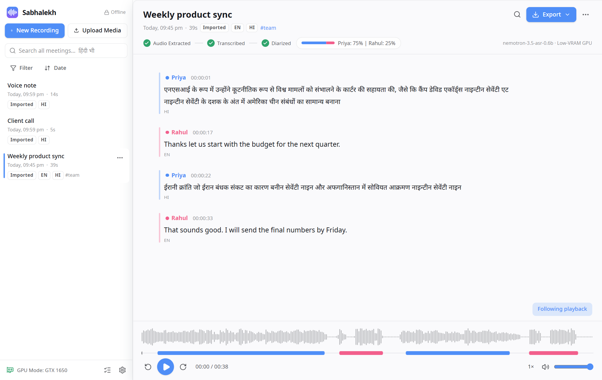
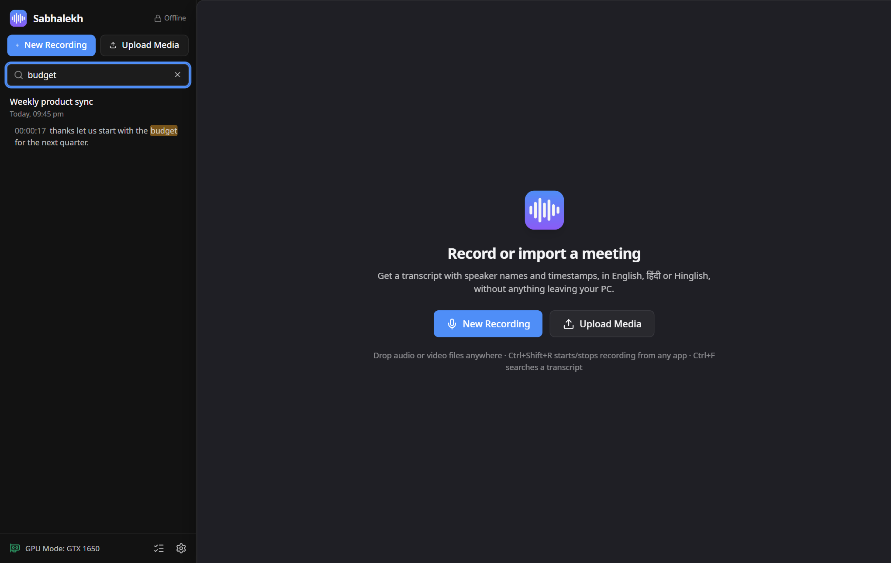
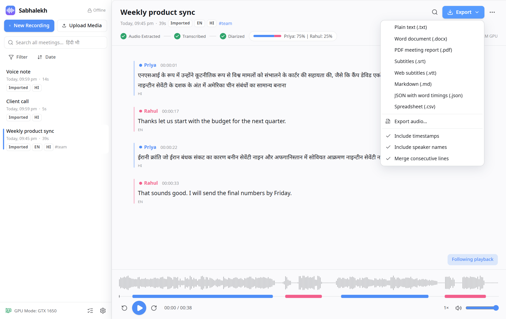
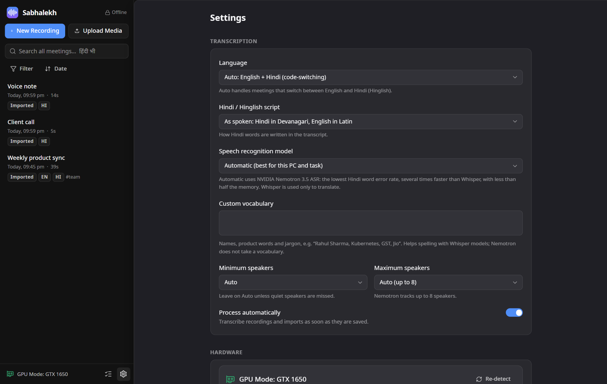
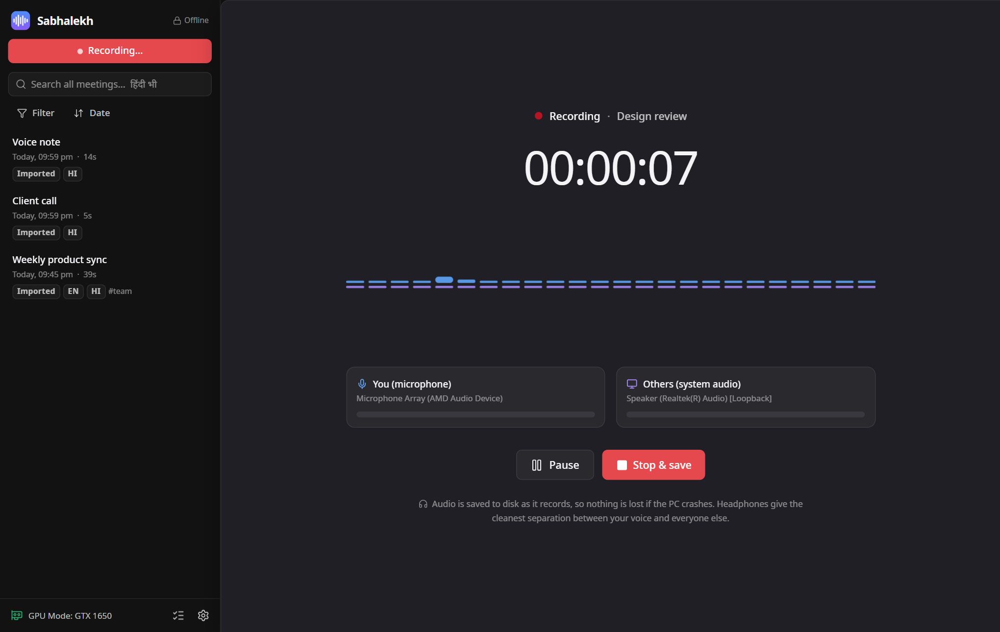
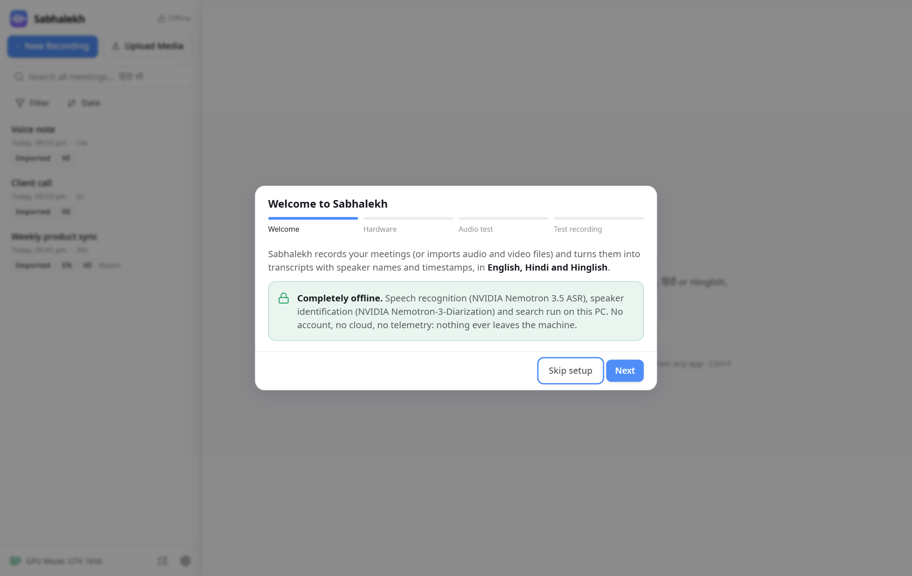
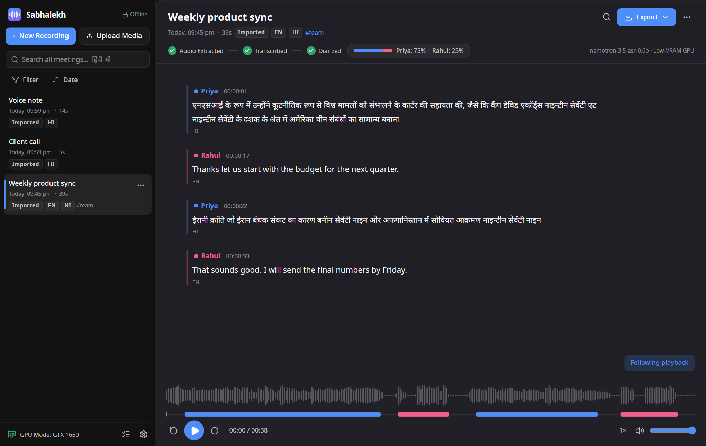
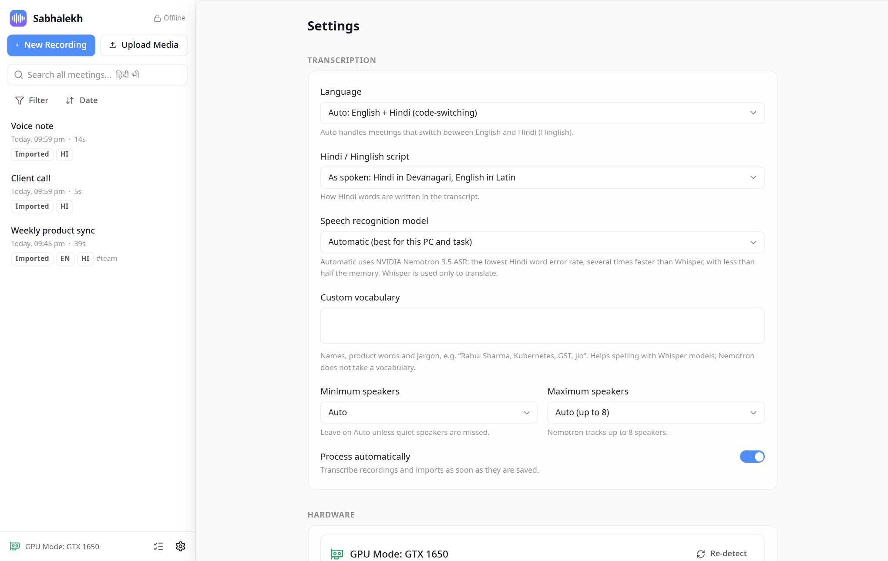

<p align="center">
  
</p>

<p align="center">
  <a href="https://github.com/anand34577/sabhalekh/releases/latest"></a>
  <a href="https://github.com/anand34577/sabhalekh/releases"></a>
  <a href="https://github.com/anand34577/sabhalekh/actions/workflows/ci.yml"></a>
  
  <a href="LICENSE"></a>
</p>

<p align="center">
  <a href="https://github.com/anand34577/sabhalekh/releases/latest"><b>Download for Windows</b></a> ·
  <a href="https://anand34577.github.io/sabhalekh/">Website</a> ·
  <a href="https://github.com/anand34577/sabhalekh/wiki">User guide</a> ·
  <a href="https://github.com/anand34577/sabhalekh/issues/new/choose">Report an issue</a>
</p>

Sabhalekh (सभालेख, "meeting record") records your Teams, Zoom or Google Meet calls, or takes an audio or video file,
and gives you a transcript that says who spoke, when, and what they said. It understands English, Hindi and the mix
of both that most of us actually speak.

Everything happens on your own computer. There is no account, no cloud service and no upload. Your recordings never
leave the PC.

<p align="center">
  
</p>

## Why Sabhalekh

- **Private by design.** Speech recognition, speaker detection and search all run locally. The app blocks its own
  network access in code, and the tests fail if anything tries to go online.
- **Made for Indian meetings.** English, Hindi and Hinglish in one transcript, with Hindi in Devanagari or in Roman
  letters, your choice. Search finds `क्या` when you type `kya`.
- **Knows who is talking.** Up to 8 speakers per meeting. Your own microphone is labelled "You", and you can rename
  everyone else with one click.
- **Runs on ordinary laptops.** On a 4 GB GTX 1650 a one-hour meeting is ready in about 5 minutes. Any graphics
  card works (NVIDIA, AMD or Intel), and so does a plain CPU.
- **Free and open source.** MIT licensed. No ads, no subscription, no telemetry.

## Features

<table>
<tr>
<td width="50%" valign="top">

### Record or import
- Records **your microphone and the other participants** as two separate tracks
- Works with Teams, Zoom, Meet in the browser, or anything else that plays sound
- Global hotkey (**Ctrl+Shift+R**) and a tray indicator while recording
- Crash-safe: an interrupted recording is recovered on the next start
- Import mp3, wav, m4a, aac, flac, ogg, wma, mp4, mkv, mov, avi or webm by drag and drop

</td>
<td width="50%" valign="top">

### Read and fix the transcript
- Click any word to play the audio from there; the current word is highlighted
- Rename a speaker everywhere at once, or move a single line to another speaker
- Edit, merge and split lines; undo any edit
- Talk time per speaker
- Find inside a meeting (**Ctrl+F**) or across all meetings from the sidebar



</td>
</tr>
<tr>
<td valign="top">

### Export anywhere
- Word (.docx), PDF meeting report, plain text, Markdown
- Subtitles (.srt, .vtt) for the recording
- JSON with word timings, CSV for spreadsheets
- With or without timestamps and names; many meetings into one ZIP



</td>
<td valign="top">

### Sensible about hardware
- Picks the fastest device by itself: graphics card, built-in graphics, or CPU
- If the graphics card runs out of memory, it moves to the next device and carries on
- Frees all memory after each meeting, so it doesn't slow down your calls
- Optional Whisper model pack for **Hindi to English translation**



</td>
</tr>
</table>

## Install

1. Download **`Sabhalekh-Setup-x.y.z.exe`** from the [latest release](https://github.com/anand34577/sabhalekh/releases/latest).
2. Run it. It installs for your user account only, so it needs no admin rights, and it needs no internet connection.
3. Open Sabhalekh. A short welcome guide checks your microphone and speakers and records a 10-second test.

The installer is large (about 600 MB) because the speech models are inside it. After that, nothing else is ever
downloaded.

> **Windows SmartScreen** may warn you because the installer is not code-signed yet. Click **More info → Run anyway**.
> Every release lists SHA-256 checksums in `SHA256SUMS.txt`, so you can check that your download is the published file.

**Requirements:** Windows 10 or 11 (64-bit), 8 GB RAM or more, and about 2 GB of free disk space. A graphics card
makes it faster but isn't required. Windows 10 needs the Microsoft Edge WebView2 Runtime, which most PCs already
have.

**Upgrading from a pre-release build called MeetScribe?** Install Sabhalekh, open it once, and your meetings move
over automatically. Then uninstall MeetScribe from Windows Settings → Apps.

## How to use it

| To… | Do this |
|---|---|
| Record a meeting | Click **New Recording** (or press **Ctrl+Shift+R** from any app), join your call, then **Stop & save** |
| Transcribe a file | Click **Upload Media**, or drag files onto the window |
| Name the speakers | Click "Speaker 1" in the transcript and type the name |
| Jump in the audio | Click any word or timestamp |
| Share the result | **Export** → pick a format |

Please tell people when you record a meeting. In many places it's required by law, and it's always polite.

The [user guide](https://github.com/anand34577/sabhalekh/wiki) explains every step with pictures, from installing to
troubleshooting.

## Screenshots

| | |
|---|---|
|  |  |
| **Recording**: your voice and the call on separate tracks | **Welcome guide** on first start |
|  |  |
| **Transcript** in the dark theme | **Settings**: language, script, model and more |

## How it works

| Part | What it uses |
|---|---|
| Speech recognition | [NVIDIA Nemotron 3.5 ASR](https://huggingface.co/nvidia/nemotron-3.5-asr-streaming-0.6b) (0.6B) on [transcribe.cpp](https://github.com/handy-computer/transcribe.cpp), on any GPU through Vulkan or on the CPU |
| Who spoke when | [NVIDIA Nemotron-3-Diarization](https://huggingface.co/nvidia/Nemotron-3-Diarization), ported to ONNX + NumPy, on the CPU at about 40× real time |
| Voice detection | Silero VAD v6 |
| Translation (optional) | OpenAI Whisper large-v3 through CTranslate2, from the Accuracy model pack |
| App | Tauri 2 + React + TypeScript; Python 3.12 backend (FastAPI, SQLite with full-text search) |

The reasoning behind each choice, with measurements, is in [docs/design-decisions.md](docs/design-decisions.md).

## Build from source

You need Windows 10/11, Python 3.12, Node.js 20+ and Rust. Then:

```powershell
git clone https://github.com/anand34577/sabhalekh.git
cd sabhalekh
py -3.12 -m venv .venv
.venv\Scripts\pip install -r backend\requirements-dev.txt
.venv\Scripts\python -m pytest tests -q          # unit tests (no models needed)
cd app; npm ci; npm test; cd ..
```

Running the app or building the installer also needs the converted models and the transcribe.cpp runtime. The
[Building from source](https://github.com/anand34577/sabhalekh/wiki/Building-from-Source) page walks through it.

## Contributing

Bug reports, ideas and pull requests are welcome. Please read [CONTRIBUTING.md](CONTRIBUTING.md) first. The user guide
lives in the [`wiki/`](wiki) folder and is published to the wiki automatically, so documentation fixes are pull requests
too.

## License and credits

Sabhalekh is released under the [MIT License](LICENSE).

The installer bundles third-party models, libraries and fonts under their own licenses, including the NVIDIA models
under the OpenMDW-1.1 license and FFmpeg libraries under the GPL/LGPL. The full list, with the license texts, is in
[THIRD_PARTY_LICENSES.md](THIRD_PARTY_LICENSES.md).

Sabhalekh is an independent project. It is not affiliated with, sponsored by or endorsed by NVIDIA, OpenAI, Microsoft,
Zoom or Google. NVIDIA and Nemotron are trademarks of NVIDIA Corporation; other names belong to their owners and are
used only to describe compatibility.
